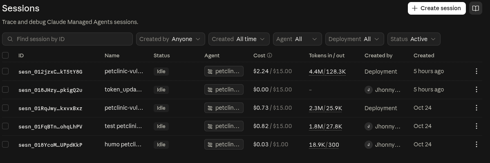
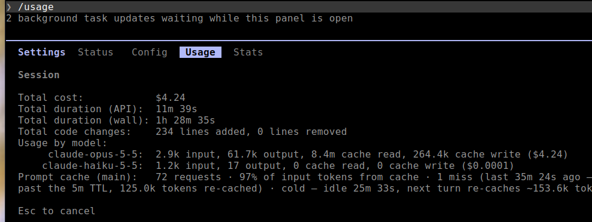

# claude-agent-vulscann
cloudfare security audit

# reference repo
git@github.com:JairoTorregrosa/jaiskills.git

# costo del agente

# costro de la construccion

# github token
https://docs.github.com/en/rest/authentication/authenticating-to-the-rest-api?apiVersion=2026-03-10#basic-authentication